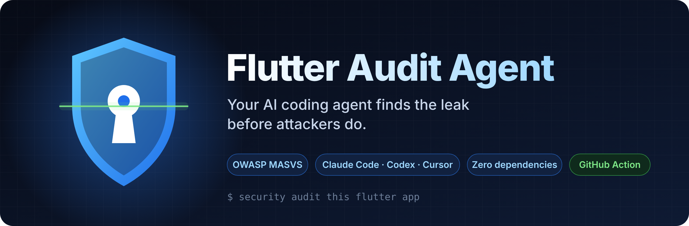
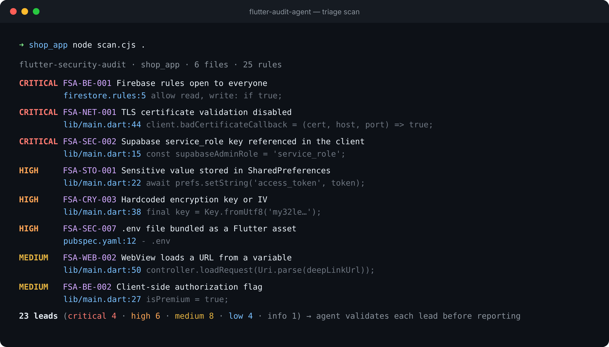
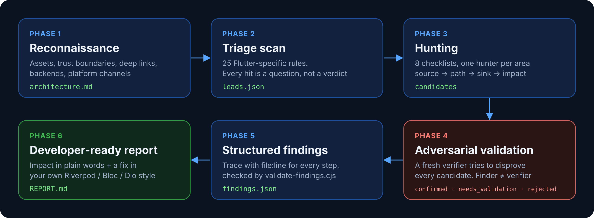

<div align="center">



<h3>Turn Claude Code, Codex or Cursor into a Flutter security auditor.</h3>

<p>An agent skill that audits Flutter &amp; Dart apps the way an attacker sees them,<br>
plus a zero-dependency scanner for your laptop and your CI.</p>

[](https://github.com/MBotirjonDev/flutter-audit-agent/actions/workflows/test.yml)
[](LICENSE)
[](https://mas.owasp.org/MASVS/)
[](#scanner-rules)
[](CONTRIBUTING.md)

[**Quick start**](#quick-start) · [**How it works**](#how-the-agent-audit-works) · [**What it catches**](#what-it-covers) · [**Contribute**](#roadmap--help-wanted) · [🇺🇿 O'zbekcha](README.uz.md)

</div>

---

> **One prompt. Real findings. Fixes in your own code style.**
>
> ```
> security audit this flutter app
> ```

<p align="center">
  
</p>
<p align="center"><sub>Real output on the intentionally vulnerable test fixture in <code>tests/fixtures/vuln_app</code>.</sub></p>

## Why this exists

Flutter apps leak in the same handful of ways, again and again:

- a Supabase **`service_role`** key or a Telegram **bot token** shipped inside the APK
- **Firestore rules** left in test mode — the whole database readable with `curl`
- refresh tokens in **SharedPreferences**, backups switched on
- `badCertificateCallback => true` left over from a dev server
- a **deep link → WebView → JavaScript bridge** chain that lets a link run code in your app
- `isPremium = true` set by the app, never checked by the server

Generic security tools don't know Flutter. Generic AI reviews report everything as
"critical". This skill gives your agent a Flutter-specific playbook **and** forces it to
prove each finding before reporting it.

## Quick start

### 1. As an agent skill (recommended)

```bash
npx skills add https://github.com/MBotirjonDev/flutter-audit-agent --skill flutter-security-audit --global
```

Or copy `skills/flutter-security-audit/` into `~/.claude/skills/` (Claude Code) or your
agent's skills folder.

Then open your Flutter project in the agent and ask:

```
security audit this flutter app
```
```
are my firestore rules safe?
```
```
check lib/features/payment for security issues, output to ~/audits/shop
```

### 2. As a standalone scanner

Node 18+ only. No `npm install`, no Flutter SDK needed.

```bash
git clone https://github.com/MBotirjonDev/flutter-audit-agent
node flutter-audit-agent/skills/flutter-security-audit/scripts/scan.cjs path/to/your_app
```

```
CRITICAL FSA-BE-001  Firebase rules open to everyone
         firestore.rules:5
         allow read, write: if true;
CRITICAL FSA-NET-001  TLS certificate validation disabled
         lib/core/api_client.dart:44
         client.badCertificateCallback = (cert, host, port) => true;
HIGH     FSA-STO-001  Sensitive value stored in SharedPreferences
         lib/auth/session.dart:22
         await prefs.setString('access_token', token);
...
```

Options: `--out leads.json`, `--min-severity medium`, `--fail-on high`,
`--include-tests`, `--quiet`.

### 3. In GitHub Actions

```yaml
# .github/workflows/security.yml
name: security
on: [push, pull_request]
jobs:
  flutter-security:
    runs-on: ubuntu-latest
    steps:
      - uses: actions/checkout@v4
      - uses: MBotirjonDev/flutter-audit-agent@v0
        with:
          fail-on: high   # info | low | medium | high | critical | none
```

## How the agent audit works

The scanner only finds patterns. The skill does the real audit in six phases:

<p align="center"></p>

| Phase | What happens | Output |
|---|---|---|
| 0. Setup | find every app/package in the repo, never run untrusted build scripts | — |
| 1. Recon | map assets, trust boundaries, deep links, backends, platform channels | `architecture.md` |
| 2. Triage | run the scanner, treat hits as questions | `leads.json` |
| 3. Hunt | area-by-area checklists (`checks/*.md`), parallel sub-agents if available | candidates |
| 4. Validate | a **fresh** verifier tries to disprove each candidate | confirmed / needs_validation / rejected |
| 5. Record | structured findings, checked by `validate-findings.cjs` | `findings.json` |
| 6. Report | developer-ready fixes in the project's own style | `REPORT.md` |

Principles:

- **The client is not a security boundary.** Obfuscation is not a fix for a leaked
  admin key or a missing server check.
- **Leads are not findings.** A confirmed finding needs a trace from attacker-controlled
  input to impact, with `file:line` for every step.
- **The finder never confirms its own finding.**
- **No guessed severities.** If the backend isn't in the repo, the finding is
  `needs_validation` with the exact missing fact.

## What it covers

| Area | Guide |
|---|---|
| Secrets in the binary (admin keys, bot tokens, payment keys, `.env` assets) | [`checks/SECRETS.md`](skills/flutter-security-audit/checks/SECRETS.md) |
| Data at rest (SharedPreferences, Hive, sqflite, logs) | [`checks/STORAGE.md`](skills/flutter-security-audit/checks/STORAGE.md) |
| Network (TLS, cleartext, ATS, pinning) | [`checks/NETWORK.md`](skills/flutter-security-audit/checks/NETWORK.md) |
| Android & iOS platform (manifest, exported components, backups) | [`checks/PLATFORM.md`](skills/flutter-security-audit/checks/PLATFORM.md) |
| WebViews & deep links | [`checks/WEBVIEW-DEEPLINKS.md`](skills/flutter-security-audit/checks/WEBVIEW-DEEPLINKS.md) |
| Backend: Firebase rules, Supabase RLS, REST/IDOR, payments | [`checks/BACKEND.md`](skills/flutter-security-audit/checks/BACKEND.md) |
| Crypto (hardcoded keys, weak hashes, randomness) | [`checks/CRYPTO.md`](skills/flutter-security-audit/checks/CRYPTO.md) |
| Build & release (obfuscation, signing, CI, Flutter web) | [`checks/BUILD.md`](skills/flutter-security-audit/checks/BUILD.md) |

### Scanner rules

| Rule | What it looks for | Severity hint | MASVS |
|---|---|---|---|
| `FSA-SEC-001` | Google / Firebase API key in source | medium | MASVS-STORAGE-2 |
| `FSA-SEC-002` | Supabase service_role key referenced in the client | critical | MASVS-STORAGE-2 |
| `FSA-SEC-003` | Hardcoded secret-looking string | high | MASVS-STORAGE-2 |
| `FSA-SEC-004` | Private key material in the repository | critical | MASVS-CRYPTO-2 |
| `FSA-SEC-005` | Live payment provider secret key | critical | MASVS-STORAGE-2 |
| `FSA-SEC-006` | Telegram bot token in source | high | MASVS-STORAGE-2 |
| `FSA-SEC-007` | .env file bundled as a Flutter asset | high | MASVS-STORAGE-2 |
| `FSA-STO-001` | Sensitive value stored in SharedPreferences | high | MASVS-STORAGE-1 |
| `FSA-STO-002` | Hive box opened without encryption | low | MASVS-STORAGE-1 |
| `FSA-LOG-001` | Sensitive value written to logs | medium | MASVS-STORAGE-2 |
| `FSA-NET-001` | TLS certificate validation disabled | critical | MASVS-NETWORK-1 |
| `FSA-NET-002` | Cleartext HTTP endpoint | medium | MASVS-NETWORK-1 |
| `FSA-NET-003` | Android allows cleartext traffic | medium | MASVS-NETWORK-1 |
| `FSA-IOS-001` | iOS App Transport Security disabled | medium | MASVS-NETWORK-1 |
| `FSA-AND-001` | Android app marked debuggable | high | MASVS-RESILIENCE-4 |
| `FSA-AND-002` | Android backups enabled | low | MASVS-STORAGE-2 |
| `FSA-AND-003` | Exported Android component (review) | info | MASVS-PLATFORM-1 |
| `FSA-BLD-001` | Release build without code shrinking | low | MASVS-RESILIENCE-3 |
| `FSA-WEB-001` | JavaScript bridge exposed to a WebView | medium | MASVS-PLATFORM-2 |
| `FSA-WEB-002` | WebView loads a URL from a variable | medium | MASVS-PLATFORM-2 |
| `FSA-CRY-001` | Weak hash (MD5/SHA-1) | medium | MASVS-CRYPTO-1 |
| `FSA-CRY-002` | Non-cryptographic Random used | low | MASVS-CRYPTO-1 |
| `FSA-CRY-003` | Hardcoded encryption key or IV | high | MASVS-CRYPTO-2 |
| `FSA-BE-001` | Firebase rules open to everyone | critical | MASVS-AUTH-1 |
| `FSA-BE-002` | Client-side authorization flag | medium | MASVS-AUTH-2 |

Suppress a reviewed line with `// fsa-ignore: FSA-CRY-002 quiz shuffle only`.

Tested against [`flutter/samples`](https://github.com/flutter/samples) (1,266 files):
zero high or critical leads, only low/info hardening hints.

## Roadmap — help wanted

Good first contributions (each is a rule + a fixture + a test):

- [ ] Supabase migrations: table created without `enable row level security`
- [ ] Firestore rules: `if request.auth != null` with no ownership check
- [ ] Dio `LogInterceptor(requestHeader: true)` outside `kDebugMode`
- [ ] `flutter_inappwebview` with `allowFileAccessFromFileURLs: true`
- [ ] Android `FileProvider` sharing `root-path`
- [ ] iOS custom URL scheme without Universal Links
- [ ] Payme / Click / Uzum: payment success trusted from the client
- [ ] OAuth `client_secret` in a mobile app
- [ ] `release` build type using `signingConfigs.debug`
- [ ] SARIF output for GitHub code scanning

See [CONTRIBUTING.md](CONTRIBUTING.md) — adding a rule takes about 15 minutes.

## Limits

This is triage and a structured method, not a guarantee. The scanner cannot see
authorization logic, server code that isn't in the repo, or runtime behaviour. Agent
audits miss things, and repeated runs find more. Use it to catch the common, costly
mistakes early — not as a replacement for a professional pentest of a high-risk app.

Only scan code you own or are authorized to test.

## Part of a toolkit

Four zero-dependency agent skills that share the same lead → validate → report workflow.
They work well together on a typical Flutter + Supabase + Telegram stack.

| Skill | What it covers |
|---|---|
| **[Flutter Audit Agent](https://github.com/MBotirjonDev/flutter-audit-agent)** (you are here) | Security audit for Flutter & Dart apps: secrets, storage, TLS, WebViews, Firebase rules |
| [Telegram Mini App Audit](https://github.com/MBotirjonDev/telegram-miniapp-audit) | Security audit for Telegram bots and Mini Apps: initData, bot tokens, webhooks, payments |
| [Supabase RLS Audit](https://github.com/MBotirjonDev/supabase-rls-audit) | Row Level Security audit: open tables, weak policies, definer views and functions, storage |
| [Flutter Release Checker](https://github.com/MBotirjonDev/flutter-release-checker) | Finds what gets Flutter apps rejected by Google Play and the App Store |

## Star history

If this saved you from shipping a leaked key, a ⭐ helps other Flutter devs find it.

[](https://star-history.com/#MBotirjonDev/flutter-audit-agent&Date)

## License

MIT © [Botirjon (@MBotirjonDev)](https://github.com/MBotirjonDev)

Inspired by the multi-phase design of [cloudflare/security-audit-skill](https://github.com/cloudflare/security-audit-skill).
