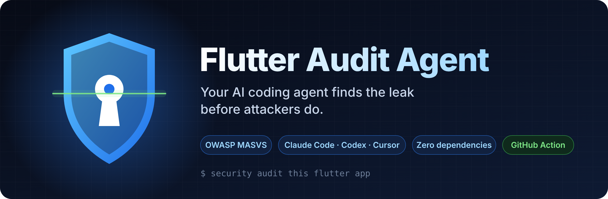
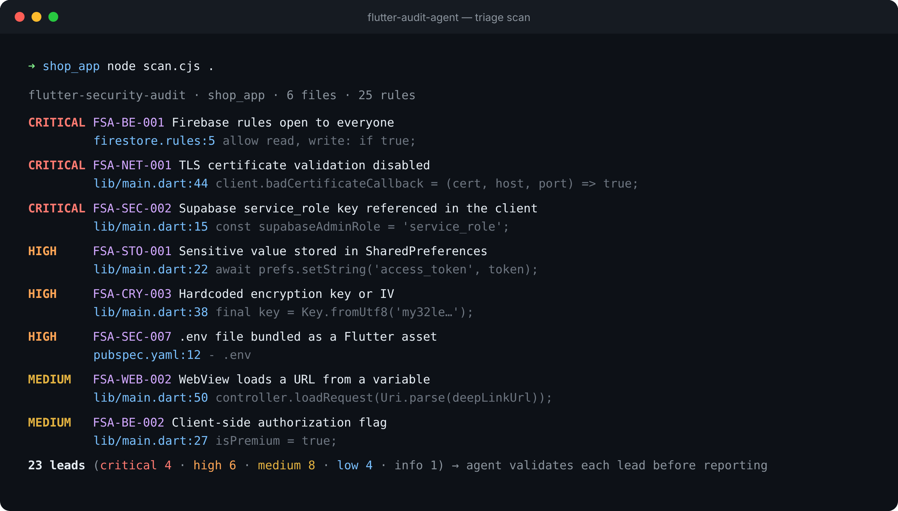
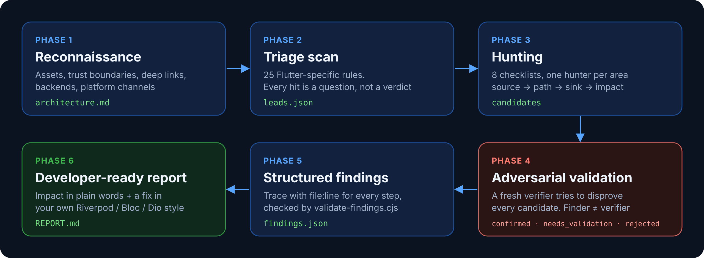

<div align="center">



</div>

# Flutter Audit Agent 🇺🇿

**AI agentingizni Flutter xavfsizlik auditoriga aylantiring.**

Claude Code, Codex, Cursor va boshqa AI kod agentlari uchun skill. U Flutter/Dart
ilovalarni hujumchi ko'zi bilan tekshiradi. Bundan tashqari, kompyuteringizda yoki CI'da
ishlaydigan, hech qanday bog'liqliksiz skaner ham bor.

## Nimalarni topadi

- APK ichida qolib ketgan Supabase `service_role` kaliti, Telegram bot tokeni, Payme/Click/Stripe maxfiy kalitlari
- "test mode"da qolgan Firestore qoidalari (butun baza `curl` bilan ochiq)
- SharedPreferences'da saqlangan token, yoqilgan backup
- release build'da `badCertificateCallback => true`
- deep link → WebView → JavaScript bridge zanjiri
- server tekshirmaydigan `isPremium = true`

## Tez boshlash

```bash
# Agent skill sifatida o'rnatish
npx skills add https://github.com/MBotirjonDev/flutter-audit-agent --skill flutter-security-audit --global

# Yoki skanerni to'g'ridan-to'g'ri ishga tushirish (faqat Node 18+ kerak)
node skills/flutter-security-audit/scripts/scan.cjs path/to/your_app
```

Agentga shunday deb yozing: `security audit this flutter app` yoki `firestore qoidalarim xavfsizmi?`

<p align="center"></p>

## Qanday ishlaydi

<p align="center"></p>

1. **Razvedka** — ilova xaritasi, ishonch chegaralari, deep link'lar, backend.
2. **Skaner** — 25 qoida; har bir signal savol, hukm emas.
3. **Qidiruv** — 8 ta checklist bo'yicha.
4. **Tekshirish** — topilmani boshqa agent rad etishga urinadi.
5. **findings.json** — har bir qadam `fayl:qator` bilan.
6. **REPORT.md** — loyihangiz uslubida tayyor tuzatish.

## Hissa qo'shish

Yangi qoida qo'shish 15 daqiqa vaqt oladi: regex, fixture va test. Batafsil
[CONTRIBUTING.md](CONTRIBUTING.md)da. Talabalar va boshlovchilar uchun `good first issue`
belgili vazifalar bor.

Faqat o'zingizga tegishli yoki tekshirishga ruxsatingiz bor kodni skanerlang.

## Boshqa skill'lar

Shu muallifning boshqa bepul agent skill'lari:

- [Telegram Mini App Audit](https://github.com/MBotirjonDev/telegram-miniapp-audit) — Security audit for Telegram bots and Mini Apps: initData, bot tokens, webhooks, payments
- [Supabase RLS Audit](https://github.com/MBotirjonDev/supabase-rls-audit) — Row Level Security audit: open tables, weak policies, definer views and functions, storage
- [Flutter Release Checker](https://github.com/MBotirjonDev/flutter-release-checker) — Finds what gets Flutter apps rejected by Google Play and the App Store
